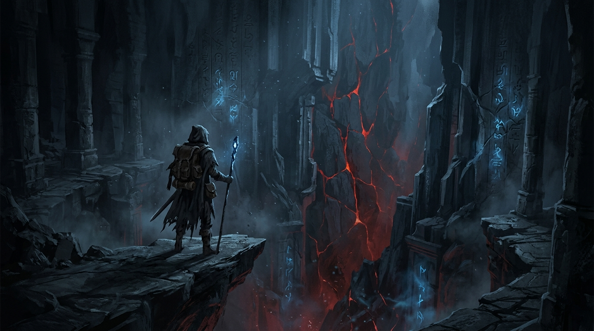

# Dungeon Crawler RPG — O Abismo Lembra

[](https://github.com/leonardoconstantino/dungeon-crawler-rpg/actions/workflows/deploy.yml)
[](https://react.dev/)
[](https://vitejs.dev/)
[](https://tailwindcss.com/)
[](https://www.typescriptlang.org/)
[](https://opensource.org/licenses/MIT)

> **"Um abismo infinito que cresce junto com você, lembra de cada vez que você caiu e transforma suas mortes em poder para a próxima descida."**

🎮 **[Clique aqui para Jogar Agora no GitHub Pages](https://leonardoconstantino.github.io/dungeon-crawler-rpg/)**

---



---

## 📖 Sobre o Jogo

**Dungeon Crawler RPG — O Abismo Lembra** é um roguelite *dungeon crawler* 2D *top-down* de exploração procedural infinita, progressão contínua, combate em tempo real e descidas compartilháveis por semente (*seed*).

O jogo não é sobre invencibilidade, mas sobre a ansiedade da impermanência: à medida que o jogador conquista poder, a **Fome do Abismo** se ajusta e intensifica as ameaças. Cada morte deixa marcas ambientais persistentes e alimenta o **Altar da Ascensão** para a próxima vida.

---

## ✨ Principais Recursos

- **Geração Procedural Determinística (Seeds):**
  - Motor PRNG *Mulberry32*: uma mesma *seed* reproduz exatamente as mesmas salas, corredores, pilares, baús, fissuras, escadas e inimigos.
  - Compartilhamento instantâneo via link URL com parâmetro `?seed=...`.
  - Escalonamento infinito de dificuldade com chefes colossais a cada 10 andares (*A Sombra da Fome*).

- **Combate em Tempo Real & Classes de Inimigos:**
  - Protagonista (*O Descendente*): ataque ágil com lâmina e 4 habilidades ativas com tempo de recarga (*Golpe em Arco*, *Investida Espectral*, *Pulso do Vazio* e *Resguardo do Amuleto*).
  - Inimigos com silhuetas e comportamentos legíveis: **Goblins** frenéticos, **Orcs** pesados com golpes de chão, **Arqueiros** que mantêm distância e **Magos** que projetam zonas de perigo telegrafadas.
  - Variantes **Elites** e **Chefes** com anomalias carmesins.

- **Fog-of-War Dinâmico:**
  - 3 estados visuais com iluminação suave radial do amuleto: *Não Explorado* (escuridão absoluta), *Explorado fora da visão* (ardósia fosca) e *Visível*.

- **Sistema de Mochila & Equipamentos:**
  - Grade clássica de 20 slots de inventário e 5 slots de corpo (*Arma, Armadura, Anel 1, Anel 2 e Amuleto*).
  - Painel comparativo de atributos lado a lado com diferenciais de ganho/perda (`+X` / `-X`).
  - Suporte completo a anéis duplos e descarte seguro em tela.

- **Morte Significativa & Altar da Ascensão:**
  - A morte gera um *Vestígio de Alma* (lápide espectral) na coordenada exata da queda, permitindo recuperar parte da experiência em futuras descidas na mesma semente.
  - Moeda persistente (**Vestígios do Abismo**) utilizada no *Altar da Ascensão* para evoluir atributos permanentes (*Vida, Ataque, Visão, Redução de Recarga e Sorte*).

- **Trilha Sonora Adaptativa ("Folk Fúnebre Sintético"):**
  - Sintetizada 100% em tempo real com **Web Audio API**: tema de exploração cavernoso, percussão tribal em combate e motivo de 4 notas (*"A Pedra Lembra"*).
  - Controles separados de volume para Música, SFX e Master.

- **Experiência Multiplataforma (Desktop & Mobile):**
  - Suporte completo a controles de teclado e mouse no desktop.
  - Gamepad virtual flutuante e arco ergonômico de ações otimizado para telas sensíveis ao toque em modo paisagem.

---

## 🎮 Controles

### Desktop (Teclado & Mouse)
| Ação | Tecla / Controle |
|---|---|
| **Movimentar** | `W`, `A`, `S`, `D` ou `Setas Direcionais` |
| **Ataque Primário** | `Barra de Espaço` ou `Clique Esquerdo` |
| **Habilidade I (Golpe em Arco)** | Tecla `1` |
| **Habilidade II (Investida Espectral)** | Tecla `2` |
| **Habilidade III (Pulso do Vazio)** | Tecla `3` |
| **Habilidade IV (Resguardo do Amuleto)** | Tecla `4` |
| **Beber Frasco de Sangue** | Tecla `Q` |
| **Abrir/Fechar Mochila** | Tecla `I` ou `B` |
| **Pausar Jogo** | Tecla `ESC` |

### Mobile (Gamepad Virtual)
- **Polegar Esquerdo:** Analógico virtual flutuante para movimentação em 8 direções.
- **Polegar Direito:**
  - Botão grande central: **Golpear** (ataque primário com repetição contínua).
  - Botões menores em arco: **Habilidades I, II, III e IV** (com indicador de recarga).
  - Botões auxiliares: **Frasco de Vida** e **Mochila**.

---

## 🛠️ Tecnologias Utilizadas

- **[React 19](https://react.dev/)**: Interface declarativa com hooks e renderização modular.
- **[TypeScript 7](https://www.typescriptlang.org/)**: Tipagem estática rigorosa para física, entidades e estados do jogo.
- **[Vite 8](https://vitejs.dev/)**: Bundler ultrarrápido configurado para deploy automático em subdiretórios no GitHub Pages.
- **[Tailwind CSS v4](https://tailwindcss.com/)**: Estilização moderna e responsiva no tema dark fantasy.
- **[Web Audio API](https://developer.mozilla.org/en-US/docs/Web/API/Web_Audio_API)**: Síntese de áudio adaptativa e efeitos sonoros gerados em tempo real sem arquivos pesados.
- **HTML5 Canvas 2D**: Renderização pixelada de alto desempenho a 60 FPS com câmera móvel e iluminação dinâmica.

---

## 🚀 Como Rodar Localmente

### Pré-requisitos
- [Node.js](https://nodejs.org/) versão 18 ou superior
- Gerenciador de pacotes `npm`

### Passo a Passo

1. **Clone o repositório:**
   ```bash
   git clone https://github.com/leonardoconstantino/dungeon-crawler-rpg.git
   cd dungeon-crawler-rpg
   ```

2. **Instale as dependências:**
   ```bash
   npm install
   ```

3. **Inicie o servidor de desenvolvimento:**
   ```bash
   npm run dev
   ```
   Acesse a URL indicada no terminal (geralmente `http://localhost:3000` ou `http://localhost:5173`).

4. **Gerar a build de produção:**
   ```bash
   npm run build
   ```
   Os arquivos finais otimizados serão gerados no diretório `dist/`.

---

## 🔄 Deploy Contínuo (GitHub Actions)

O repositório está configurado para publicação automatizada através do arquivo [`.github/workflows/deploy.yml`](.github/workflows/deploy.yml).

Sempre que alterações forem enviadas (*push*) para as branches `main` ou `master`:
1. Uma máquina virtual Ubuntu é provisionada com Node.js 20.
2. O workflow instala as dependências e roda `npm run build` com a variável `GITHUB_ACTIONS: true` (ajustando a base do Vite dinamicamente para `/dungeon-crawler-rpg/`).
3. O diretório `dist/` gerado é enviado via `actions/upload-pages-artifact@v3` e publicado automaticamente no GitHub Pages via `actions/deploy-pages@v4`.

---

## 📄 Licença

Este projeto está licenciado sob a Licença MIT — consulte o arquivo de licença para mais detalhes.
